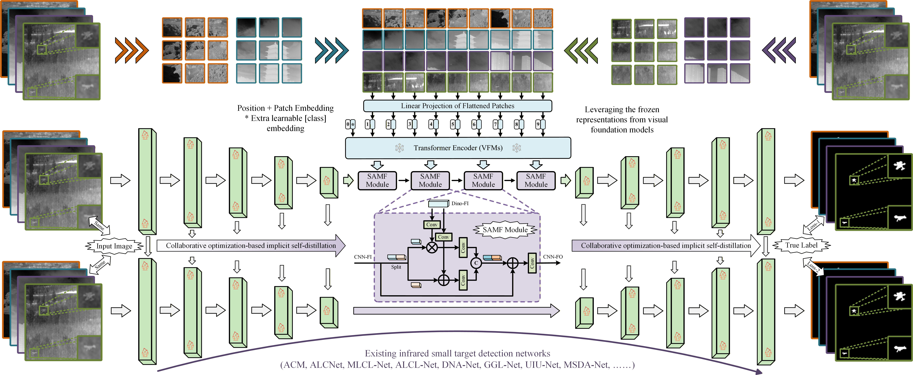
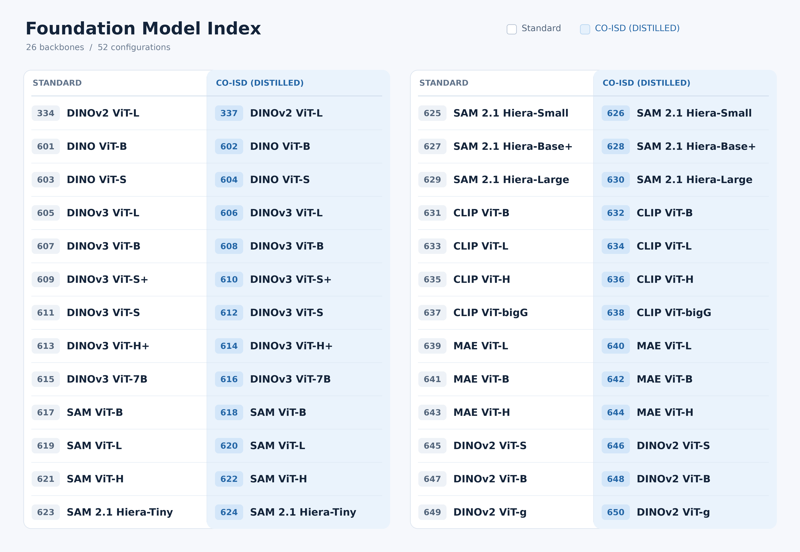
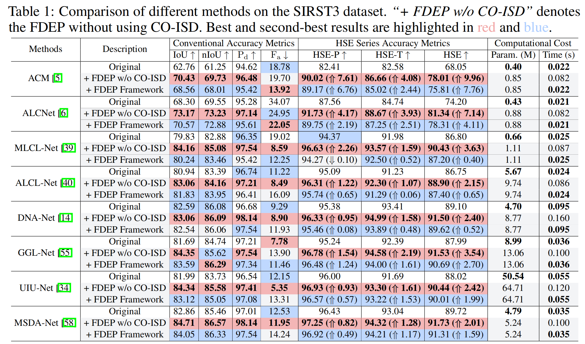
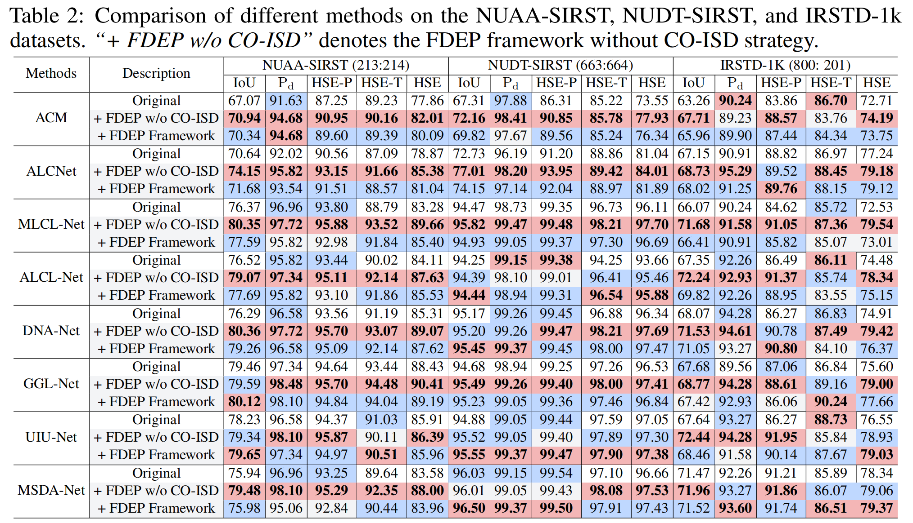
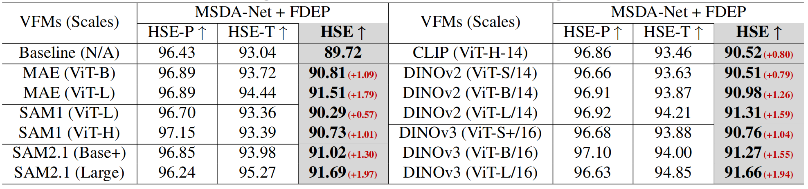

<div align="center">
  <h1 style="border-bottom: none;">Rethinking Infrared Small Target Detection: A Foundation-Driven Efficient Paradigm</h1>
</div>

<div align="center">
  <p>
    <a href="https://scholar.google.com/citations?user=Dd4_VW8AAAAJ&hl=zh-CN" target="_blank">Chuang Yu</a><sup>1,2,6</sup>,&nbsp
    <a href="https://scholar.google.com/citations?user=3cBa6r4AAAAJ&hl=zh-CN" target="_blank">Jinmiao Zhao</a><sup>1,2</sup>,&nbsp
    <a href="https://scholar.google.com/citations?user=Dd4_VW8AAAAJ&hl=zh-CN" target="_blank">Yunpeng Liu</a><sup>1*</sup>,&nbsp
    <a href="https://iron-lyk.github.io/" target="_blank">Yaokun Li</a><sup>3</sup>,&nbsp
    <a href="https://scholar.google.com/citations?user=Dd4_VW8AAAAJ&hl=zh-CN" target="_blank">Xiujun Shu</a><sup>2</sup>,
    <br>
    <a href="https://scholar.google.com/citations?hl=zh-CN&user=emdXrWoAAAAJ" target="_blank">Yuanhao Feng</a><sup>4</sup>,&nbsp
    <a href="https://openreview.net/profile?id=~Bo_Wang50" target="_blank">Bo Wang</a><sup>5</sup>,&nbsp
    <a href="https://scholar.google.com/citations?user=-xQ-C1sAAAAJ&hl=zh-CN" target="_blank">Xiangyu Yue</a><sup>6*</sup>
  </p>
  <p>
    <sup>1</sup> Shenyang Institute of Automation, Chinese Academy of Sciences
     <br>
    <sup>2</sup> University of Chinese Academy of Sciences &nbsp;&nbsp;
    <sup>3</sup> Sun Yat-sen University &nbsp;&nbsp;
    <sup>4</sup>  Peking University &nbsp;&nbsp;
      <br>
    <sup>5</sup>  Northwestern Polytechnical University &nbsp;&nbsp;
    <sup>6</sup> MMLab, The Chinese University of Hong Kong
  </p>
</div>

<p align="center">
  <a href="https://arxiv.org/abs/2512.05511"></a>
  <a href="https://github.com/YuChuang1205"></a>
  <!-- <a href="#"></a> -->
  <!-- <a href="https://opensource.org/licenses/Apache-2.0"></a> -->
  <a href="#"></a>
  <a href="https://www.python.org/downloads/"></a>
</p>

<p align="center">
 <a href="#"><strong>🎉 Accepted by NeurIPS 2026 🎉</strong></a>
</p>

<p align="center">
  <a href="#"><strong>Learn from visual foundation models. Deploy with the original lightweight detector.</strong></a>
</p>

<p align="center">
  <a href="#"><strong>以视觉基础模型增强红外小目标检测，结合 CO-ISD 实现无额外基础模型推理开销的高效部署！</strong></a>
</p>


The first general framework to transfer visual foundation model (VFM) representations to SIRST detection by bridging the modality gap between natural and infrared images. This code is developed based on my previous [**PAL framework (ICCV 2025)**](https://github.com/YuChuang1205/PAL). This repository integrates eight SIRST detectors ([**ACM**](https://arxiv.org/abs/2009.14530), [**ALCNet**](https://arxiv.org/abs/2012.08573), [**MLCL-Net**](https://doi.org/10.1016/j.infrared.2022.104107), [**ALCL-Net**](https://ieeexplore.ieee.org/document/9785618), [**DNANet**](https://arxiv.org/abs/2106.00487), [**GGL-Net**](https://ieeexplore.ieee.org/abstract/document/10230271), [**UIUNet**](https://arxiv.org/abs/2212.00968), and [**MSDA-Net**](https://arxiv.org/abs/2406.02037)), multiple VFM configurations ([**DINOv1**](https://github.com/facebookresearch/dino), [**DINOv2**](https://github.com/facebookresearch/dinov2), [**DINOv3**](https://github.com/facebookresearch/dinov3), [**MAE**](https://github.com/facebookresearch/mae), [**SAM**](https://github.com/facebookresearch/segment-anything), [**SAM2.1**](https://github.com/facebookresearch/sam2), [**CLIP**](https://github.com/openai/CLIP)), and four public datasets ([**SIRST3**](https://arxiv.org/pdf/2304.01484)), ([**SIRST**](https://ieeexplore.ieee.org/document/9423171), [**NUDT-SIRST**](https://ieeexplore.ieee.org/document/9864119), and [**IRSTD-1k**](https://ieeexplore.ieee.org/document/9880295)). The code provides separate training scripts for **"original detectors"**, **"+ FDEP without CO-ISD"**, and **"+ FDEP"**, together with tools for independent testing and evaluation. **We welcome pull requests to integrate more detectors and foundation models!**🌸🌸🌸


## 🔥 News
- 2026.10 🌟🌟 We set up a [**WeChat group**](#wechat-group) for discussion.
- 2026.10 🌟🌟 We have released the **Complete Code**.
- 2026.09 🎉🎉 Our paper has been accepted by **NeurIPS 2026**!
- 2025.12 🌟🌟 We have released the [FDEP Manuscript](https://arxiv.org/abs/2512.05511).

## 🚀 Overview
<div align="center">
<br>
  
<br>
</div>

## Datasets
<details>
<summary><b>1. Original datasets (optional)</b></summary>

**You can skip this step and directly use the prepared datasets in Step 2.**

* **NUDT-SIRST** [[Original dataset](https://pan.baidu.com/s/1WdA_yOHDnIiyj4C9SbW_Kg?pwd=nudt)] [[Paper](https://ieeexplore.ieee.org/document/9864119)]
* **SIRST** [[Original dataset](https://github.com/YimianDai/sirst)] [[Paper](https://ieeexplore.ieee.org/document/9423171)]
* **IRSTD-1k** [[Original dataset](https://drive.google.com/file/d/1JoGDGF96v4CncKZprDnoIor0k1opaLZa/view)] [[Paper](https://ieeexplore.ieee.org/document/9880295)]
* **SIRST3** [[Original dataset](https://github.com/XinyiYing/LESPS)] [[Paper](https://arxiv.org/pdf/2304.01484)]

</details>

<details>
<summary><b>2. Prepared datasets (ready to use)</b></summary>

**These datasets are prepared from the original datasets and can be used directly with our code.**

* [💎 Download the datasets required by our code](https://pan.baidu.com/s/1_QIs9zUM_7MqJgwzO2aC0Q?pwd=1234) (access code: `1234`)

</details>


## Three configurations
| Configuration | Training | Inference |
| --- | --- | --- |
| Original detector | Task-specific detector | Original detector |
| + FDEP w/o CO-ISD | Frozen VFM + SAMF + detector | VFM-enhanced main branch |
| + FDEP | Frozen VFM + SAMF + detector + CO-ISD | Original detector (Lightweight branch only) |


## How to use our code

<details>
<summary><b>1. Download the dataset</b></summary>

Download the datasets from [Baidu Netdisk](https://pan.baidu.com/s/1_QIs9zUM_7MqJgwzO2aC0Q?pwd=1234) (access code: `1234`).

After cloning the repository in Step 2, extract the downloaded archive into the project root directory.

</details>

<details>
<summary><b>2. Clone the repository</b></summary>

```bash
git clone https://github.com/YuChuang1205/FDEP-Framework.git
cd FDEP-Framework
```

</details>

<details>
<summary><b>3. Create a Conda environment</b></summary>

```bash
conda create -n FDEP python=3.8
conda activate FDEP
```

</details>

<details>
<summary><b>4. Install dependencies</b></summary>

```bash
pip install torch==1.13.1+cu116 torchvision==0.14.1+cu116 torchaudio==0.13.1 --extra-index-url https://download.pytorch.org/whl/cu116
pip install segmentation_models_pytorch -i https://pypi.tuna.tsinghua.edu.cn/simple
pip install PyWavelets -i https://pypi.tuna.tsinghua.edu.cn/simple
pip install scikit-image -i https://pypi.tuna.tsinghua.edu.cn/simple
pip install albumentations==1.3.0 -i https://pypi.tuna.tsinghua.edu.cn/simple
pip install scikit-learn matplotlib thop h5py SimpleITK medpy yacs torchinfo
```

</details>

<details>
<summary><b>5. Train the model</b></summary>

The default detector and dataset are **MSDA-Net** and **SIRST3**, respectively. To use other configurations, modify the settings at the beginning of the corresponding `train_*.py` script.

The value of `model_name_num` specifies the foundation model to use. See the [**Foundation Model Index**](#foundation-model-index) below for the mapping.

```bash
# Original detector
# python train_001_original.py

# Original detector + FDEP w/o CO-ISD
python train_002_with_FDEP_without_CO-ISD.py

# Original detector + FDEP
# python train_003_with_FDEP.py
```

</details>

<details>
<summary><b>6. Test the model</b></summary>

To save prediction images or run standalone tests, use the scripts in the `tools_for_test` folder. Copy the required scripts to the project root directory and update the model checkpoint path before running:

```bash
python test_004_only_dino_no_binary.py
```

</details>

<details>
<summary><b>7. Evaluate performance (optional)</b></summary>

For additional evaluation, run:

```bash
python cal_mIoU_and_nIoU_for_no_binary.py
python cal_PD_and_Fa_for_no_binary.py
python cal_total_metric_fast.py
```

</details>


    
<a id="foundation-model-index"></a>
## Foundation Model Index
<details>
<summary><b>Click to expand the Foundation Model Index</b></summary>
<div align="center">
<br>
  
<br>
</div>
</details>

## Results
<details>
<summary><b>Quantitative Results on the SIRST3 Dataset</b></summary>

<div align="center">
  <br>
  
  <br>
</div>

</details>

<details>
<summary><b>Quantitative Results on the Three Individual Datasets</b></summary>

<div align="center">
  <br>
  
  <br>
</div>

</details>

<details>
<summary><b>Quantitative Results on Different Visual Foundation Models (VFMs)</b></summary>

<div align="center">
  <br>
  
  <br>
</div>

</details>


<a id="wechat-group"></a>
## 微信交流群（2026-10-30）

<details>
<summary><b>点击展开微信群说明及二维码</b></summary>

🚑🚑 为方便交流本开源框架的使用与扩展问题，我们建立了微信群（与 PAL 框架共用同一个交流群）。

**若二维码过期，请在 GitHub Issues 中留言，我将及时更新。**

<p align="center">
  
</p>

</details>


## Citation

If you find this repo helpful, please give us a 🤩**star**🤩. Please consider citing the **FDEP** if it benefits your project. <br>  

BibTeX reference is as follows.
```
@article{yu2025rethinking,
  title={Rethinking infrared small target detection: A foundation-driven efficient paradigm},
  author={Yu, Chuang and Zhao, Jinmiao and Liu, Yunpeng and Li, Yaokun and Shu, Xiujun and Feng, Yuanhao and Wang, Bo and Dai, Yimian and Yue, Xiangyu},
  journal={arXiv preprint arXiv:2512.05511},
  year={2025}
}
```


## Other link 
1. My homepage: [[YuChuang](https://github.com/YuChuang1205)]
2. My "PAL Framework" project code (ICCV2025)：[[Link](https://github.com/YuChuang1205/PAL)] 


